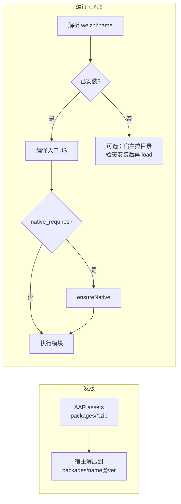

# Weizhi Package（官方 JS 包）设计方案

> **状态：提案（未实现）**  
> 本文描述目标形态与迁移路径；**当前主干仍以** [`setScriptFolder` catalog](MODULE_LOADING.md) **为准**。规格定稿并落地后，再更新 DECISIONS / 引擎与宿主 API。

**相关**：[MODULE_LOADING.md](MODULE_LOADING.md)、[HOST_ABI.md](HOST_ABI.md)、[NATIVE_PLUGIN_IDL.md](NATIVE_PLUGIN_IDL.md)、[QUICKJS_LIB_COMPAT.md](QUICKJS_LIB_COMPAT.md)、[INTEGRATION_FOR_AI.md](INTEGRATION_FOR_AI.md)。

---

## 1. 背景与目标

### 1.1 为什么要改

历史上 **`setScriptFolder`（catalog）** 用于：在无统一远程分发时，由宿主在本地放**单层** `leaf.js`，脚本用 `import "docx.js"` 加载。该模型存在明显限制：

- 仅支持 **扁平叶子**（`[A-Za-z0-9._-]+.js`），无法表达 `assets/`、多文件库；
- **第二套根**（catalog vs `setFsRoot`），集成方与 Agent 提示易混；
- 与「官方维护 Bundle / 可联网更新」的产品方向重复，却缺少 manifest、版本与校验。

在已有 **`fetch`**、[`host.ensureNative`](HOST_ABI.md) 与签名原生插件的前提下，希望把 **内置脚本库 + 可下载官方库** 归一到 **Package** 一种形态；**保留内置能力**，不再单独维护 catalog 概念。

### 1.2 目标（定稿后应满足）

| 目标 | 说明 |
|------|------|
| **一种产物形态** | 官方库 = 带 `manifest.json` 的目录（或等价 zip），含入口 JS、可选静态资源、可选原生依赖声明 |
| **一种导入语法（对 AI）** | 优先 `import … from "weizhi:<name>"`（可选钉版本）；不再教 `import "leaf.js"` 裸 catalog 名 |
| **内置 + 按需** | 发版可内置若干 package（离线可用）；可选从官方目录 CDN 拉取、验签/哈希后安装到同一目录布局 |
| **与用户 workspace 分离** | 官方包装在 **宿主私有只读区**，默认不在用户可写的 `setFsRoot` 下 |
| **原生扩展不塞进 .js** | 需要 SO 时在 manifest 声明 → 运行时 `host.ensureNative`，与 [HOST_ABI](HOST_ABI.md) 一致 |
| **不是 npm** | 不解析 `package.json` 依赖图、无 `node_modules`；清单由微智官方（或宿主扩展白名单）维护 |

### 1.3 非目标

- 引擎内实现 LLM `@Tool`（安装仍可由宿主注册工具，逻辑可复用宿主侧库）。
- 任意 `import from "https://…"` 作为模块说明符（下载在宿主层完成，**import 只解析本地入口**）。
- 在 Package 的 zip 内嵌未验签的 `.so` 并由脚本 `dlopen`（SO 必须走 NATIVE 目录与验签）。

---

## 2. 术语

| 术语 | 含义 |
|------|------|
| **Package** | 一个官方（或宿主白名单）发布的版本化单元：`name` + `version` + 磁盘目录树 |
| **Package 根** | 宿主上存放已安装 package 的父目录（见 §3） |
| **内置 Package** | 随 App / AAR 安装时从 assets 解压或拷贝的 package，无需首启联网 |
| **远程 Package** | 由宿主按**官方目录 manifest** 下载 artifact（通常为 zip）后安装 |
| **入口模块** | package 内 `manifest.js.entry` 指向的 `.js` 文件 |
| **引擎内置模块** | `fs`、`path`、`buffer` 等 C 模块，**不是** Package |

---

## 3. 宿主目录布局（建议约定）

以下路径均在 **应用私有存储**（Android `context.getFilesDir()` 等），对用户 workspace **不可写**。

```text
<weizhi-home>/
  packages/
    <name>@<version>/          # 例如 docx@3.2.1
      manifest.json            # 本包副本（与发布 manifest 一致或为其子集）
      index.js                 # 入口（文件名由 manifest 指定）
      assets/                  # 可选：图片、模板、二进制等
      …
  packages-index.json          # 可选：本机已安装 name → 当前解析版本（宿主维护）
  native/                      # 已有 ensureNative 缓存语义，与 HOST_ABI 对齐（不在 package 树内 dlopen）
```

**与今日 catalog 的对应关系（迁移期）**：

| 今日 | 迁移后 |
|------|--------|
| `setScriptFolder` → 单层 `foo.js` | 内置 package `foo@<ver>/`，`import "weizhi:foo"` |
| `import "docx.js"` | `import … from "weizhi:docx"`（兼容期可别名，见 §8） |

**`setFsRoot`（工作区）**：仍仅用于用户任务、Agent 产出、`import "./…"`；**不**作为官方 package 的默认安装目标。

---

## 4. Package manifest（发布契约）

每个 package 在**发布时**提供 `manifest.json`（安装后落在 package 目录内）。字段为提案 schema，实现时可增 `schema_version`。

```json
{
  "schema_version": 1,
  "name": "docx",
  "version": "3.2.1",
  "description": "Word OOXML helpers (bundle + assets)",
  "min_engine": "0.1.0",
  "js": {
    "entry": "index.js"
  },
  "assets": [
    { "path": "assets/template.bin", "sha256": "…", "size": 4096 }
  ],
  "artifact": {
    "url": "https://packages.weizhi.example/docx/3.2.1/docx-3.2.1.zip",
    "sha256": "…",
    "size": 524288
  },
  "native_requires": [
    { "plugin": "image_resize", "min_version": "2.1.0" }
  ],
  "caps_required": []
}
```

| 字段 | 必填 | 说明 |
|------|------|------|
| `name` | 是 | 稳定 ID，`[a-z0-9][a-z0-9._-]*`，对应 `weizhi:<name>` |
| `version` | 是 | semver |
| `js.entry` | 是 | package 内相对路径，必须为 `.js` |
| `assets[]` | 否 | 静态资源列表；安装后校验可选（与 zip 整体哈希二选一或并存） |
| `artifact` | 内置可省略 | 远程安装时的 zip 地址与 `sha256`；内置包由宿主从 assets 安装，可不填 `url` |
| `native_requires[]` | 否 | 加载本 package 前宿主应 `ensureNative(plugin)`；版本规则同 [HOST_ABI §4.4](HOST_ABI.md) |
| `min_engine` | 建议 | 与引擎/ABI 版本协商用 |
| `caps_required` | 否 | 需系统权限时宿主可拒绝安装 |

**发布物形态**：

1. **目录树**（开发 / 内置 assets）  
2. **zip**（远程）：zip 根含 `manifest.json` + `js.entry` + `assets/…`；解压到 `packages/<name>@<version>/`。

单文件 **bundle.js** 可作为 **仅 JS、无 assets** 的特例：`entry` 即该文件，package 目录下只有 manifest + 一个 js。

---

## 5. 模块说明符与解析（目标行为）

### 5.1 对 Agent 暴露的写法（推荐）

```javascript
import { buildDocx } from "weizhi:docx";
import { parse } from "weizhi:csv@1.0.0";   // 可选：钉版本（二期可简化为仅 name）
```

解析顺序（提案）：

1. **引擎内置名**（`fs`、`path`、`buffer`、`process`、`zlib`、`zip`）→ 现有 C 模块。  
2. **`weizhi:<name>`** 或 **`weizhi:<name>@<version>`** → Package 根下已安装目录 → `js.entry`。  
3. **路径说明符**（含 `/` 或以 `/` 开头）→ 仅 **`setFsRoot` workspace**（与今日一致），**不再**回退 catalog 叶子。  
4. 失败 → `unsupported: package "…"` / `package not installed` 等（英文关键词，见 DECISIONS）。

### 5.2 包内资源怎么用

- ES `import` **只加载 `.js`**。  
- 图片 / 模板 / 二进制：在 package 内用 **`fs` 读 package 内路径** 需要引擎支持「package 内相对路径」或导出 `import.meta` 类信息（**待实现细节**，二选一）：
  - **A**：宿主安装后把 package 挂为 **只读 VFS 根**（例如 `weizhi://docx@3.2.1/assets/foo.png` 或内部路径前缀）；  
  - **B**：入口 JS 提供 `getAssetPath(relative)`，由 prelude/宿主注入。  
- 小资源可继续 **内联 base64**（受堆限额约束，见 QUICKJS_LIB_COMPAT）。

### 5.3 禁止默认开放的行为

- `import from "https://cdn.example/lib.js"`  
- `import from "npm:lodash"`  
- 用户 workspace 下随意放的 `evil.js` 被裸名 `import "evil.js"` 加载（catalog 今日行为）—— 裸名仅保留给内置模块与 `weizhi:` 前缀。

---

## 6. 生命周期



| 阶段 | 负责方 | 说明 |
|------|--------|------|
| 内置安装 | 宿主 App 启动或首次 `WeizhiEngine` 配置 | 从 assets 安装到 `<weizhi-home>/packages/`；可不联网 |
| 远程安装 | 宿主（工具或 `WeizhiPackageManager` 类库） | 读**官方目录**（非脚本任意 URL）→ 下载 zip → `sha256` → 解压；需 `enableFetch` |
| 解析 / import | 引擎 module loader | 只读 package 目录，不写 workspace |
| 原生插件 | 宿主 + `ensureNative` | 与 package 并行；manifest `native_requires` 触发 |
| 卸载 / 升级 | 宿主策略 | 目录删 `name@old`、更新 `packages-index.json`；引擎无全局 npm  uninstall API 也可 |

**离线**：内置 package 保证核心能力；远程仅为增量化。

---

## 7. 官方目录（CDN）与内置的关系

- **目录真相**：与 [HOST_ABI 原生插件目录](HOST_ABI.md) 类似，维护 `packages` 条目的索引（name、最新兼容 version、artifact url、哈希、依赖）。  
- **脚本不直接读目录**：由宿主或可选 Java 库拉取；Agent 只写 `weizhi:docx`。  
- **内置** = 目录中某 `(name, version)` 的**快照**，随 App 发版；可在无网时只用内置快照，有网时按策略升级。

---

## 8. 与 `setScriptFolder` 的迁移

### 8.1 API（提案）

| 今日 | 目标 |
|------|------|
| `setScriptFolder(path)` | **废弃**；由 `setPackageRoot(path)` 或 `WeizhiEngine.configurePackages({ home, … })` 替代 |
| `weizhi_set_script_folder` | `weizhi_set_package_root`（C 对称） |

### 8.2 兼容期（建议 ≥1 个 minor）

- `import "docx.js"` / `import "docx"`：若存在 package `docx`，映射到 `weizhi:docx`；否则旧 catalog 路径（仅兼容层）。  
- 文档与 [AGENT_SANDBOX_PROMPT.md](AGENT_SANDBOX_PROMPT.md) 先写 **`weizhi:`**，旧写法标记 deprecated。

### 8.3 集成方（Agent1 / 第三方）

- Office 等脚本真源仍在 [Agent1](https://github.com/fengshihao/agent1)；发版改为打 **package zip** + 内置 assets，不再仅拷贝单层 `*.js` 到 catalog 根。  
- 见 [office.md](office.md)、[AGENT1_DOCX_INTEGRATION.md](AGENT1_DOCX_INTEGRATION.md)（落地后更新）。

---

## 9. 分层：引擎 vs 宿主库

| 能力 | 建议归属 |
|------|----------|
| `weizhi:` 模块解析、读 package 内 `.js` | **引擎**（C module loader + 只读路径） |
| 解压 zip、下载、目录 CDN、安装/升级策略 | **宿主**；可提供可选 **`com.weizhi.packages`** Java 库（非 LLM Tool） |
| `ensureNative` | **已有 Host ABI** |
| LLM 工具 `install_package` | **宿主注册**，内部调 Package 库 |

---

## 10. 安全

- 远程 artifact：**固定官方目录** + `sha256`（与原生插件同级严谨度；是否签名待决，见 §12）。  
- 安装路径：仅 `<weizhi-home>/packages/`；zip slip 防护（与 `zip` 模块同类规则）。  
- Package 树对 workspace **`fs` 默认不可写**；脚本通过受控 API 读 assets，避免用户脚本篡改官方包。  
- `native_requires` 只允许 manifest 声明的 plugin **name**，禁止脚本传任意 SO URL。

---

## 11. 实现阶段（建议）

| 阶段 | 交付 | 依赖 |
|------|------|------|
| **P0 文档** | 本文 + 交叉链接；DECISIONS 标记提案 | — |
| **P1 内置** | 引擎 `weizhi:` 解析；宿主内置 1～2 个示例 package；废弃 catalog 文档 | 引擎 + 宿主安装器 |
| **P2 资源** | package 内 `assets/` + 读路径 API | P1 |
| **P3 远程** | 官方目录 + 下载安装 + 测试 mock HTTP | `fetch` |
| **P4 清理** | 移除 catalog 回退；删除 `setScriptFolder` | 兼容期结束 |

测试要求（落地时）：`tests/` 或 `androidTest` 覆盖 `weizhi:` 解析、路径逃逸、未安装错误文案；远程安装用 mock HTTP（与 `FetchRedirectTest` 同类）。

---

## 12. 待决事项（评审填表）

| # | 问题 | 选项 / 备注 |
|---|------|-------------|
| D1 | Package 根 API 命名 | `setPackageRoot` vs `configurePackages({ home })` |
| D2 | 钉版本语法 | `weizhi:docx@3.2.1` 是否一期就要 |
| D3 | 包内资源路径 API | `import.meta.url` 风格 vs 宿主 `getAssetPath` vs 只读 VFS 前缀 |
| D4 | 远程 artifact 是否平台签名 | 仅 sha256 vs 与 SO 同套公钥 |
| D5 | 可选 package 是否允许宿主扩展白名单 | 仅微智官方 vs 企业自建目录 |
| D6 | 与 ROADMAP「技能区可写」关系 | 用户 Skill 是否用 package 形态，还是仅 workspace `.js` |
| D7 | `packages-index.json` 解析策略 | 每 name 默认最新兼容 vs 全局 pin |

---

## 13. 修订记录

| 日期 | 说明 |
|------|------|
| 2026-10-14 | 初稿：统一 catalog 与内置 Bundle 为 Package 提案 |
