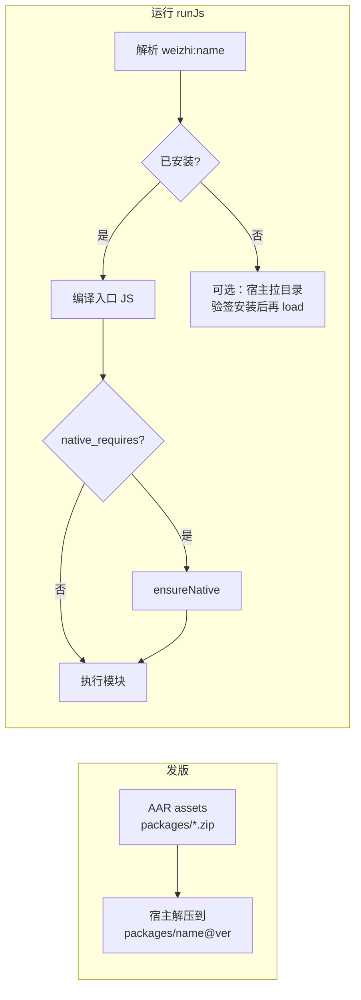

# Weizhi Package（官方 JS 包）设计方案

> **状态：P1 与 P3 已实现**（内置 `weizhi:` 解析、`PackageInstaller`、官方 Registry 客户端）。  
> API：`setPackageRoot` / `weizhi_set_package_root`；远程安装见 §7。

**相关**：[MODULE_LOADING.md](MODULE_LOADING.md)、[HOST_ABI.md](HOST_ABI.md)、[NATIVE_PLUGIN_IDL.md](NATIVE_PLUGIN_IDL.md)、[QUICKJS_LIB_COMPAT.md](QUICKJS_LIB_COMPAT.md)、[INTEGRATION_FOR_AI.md](INTEGRATION_FOR_AI.md)。

---

## 0. 已锁定决策（最简默认）

| ID | 决策 |
|----|------|
| **D1** | **`setPackageRoot(path)`** / C：`weizhi_set_package_root`。不用 `configurePackages({…})` 对象式 API（以后需要再加方法）。 |
| **D2** | 脚本 **仅** `import … from "weizhi:<name>"`。**不支持** `weizhi:<name>@<version>` 钉版本。 |
| **D3** | 包内静态资源：**`getAssetPath(relative)`** + `fs` 读 package 只读区（见 §5.2）。 |
| **D4** | 远程 zip：**仅 sha256**（官方目录条目 + manifest）。不做 Package 专用平台签名（SO 仍走 HOST_ABI 验签）。 |
| **D5** | **仅微智官方** package 目录；宿主不提供扩展目录 URL（企业私服以后再说）。 |
| **D6** | **Skill 与 Package 分离**（workspace / App 可写技能目录；不用 `weizhi:`）。 |
| **D7** | 每个 `name` 在 **`packages-index.json` 里只有一个「当前」版本**；`weizhi:<name>` 只解析该指针。磁盘上可保留旧版本目录，但脚本不可选。 |

---

## 1. 背景与目标

### 1.1 为什么要改

历史上 **`setScriptFolder`（catalog）** 用于：在无统一远程分发时，由宿主在本地放**单层** `leaf.js`，脚本用 `import "docx.js"` 加载。该模型存在明显限制：

- 仅支持 **扁平叶子**（`[A-Za-z0-9._-]+.js`），无法表达 `assets/`、多文件库；
- **第二套根**（catalog vs `setFsRoot`），集成方与 Agent 提示易混；
- 与「官方维护 Bundle / 可联网更新」的产品方向重复，却缺少 manifest、版本与校验。

在已有 **`fetch`**、[`host.ensureNative`](HOST_ABI.md) 与签名原生插件的前提下，希望把 **内置脚本库 + 可下载官方库** 归一到 **Package** 一种形态；**保留内置能力**，不再单独维护 catalog 概念。

### 1.2 目标（定稿后应满足）

| 目标 | 说明 |
|------|------|
| **一种产物形态** | 官方库 = 带 `manifest.json` 的目录（或等价 zip），含入口 JS、可选静态资源、可选原生依赖声明 |
| **一种导入语法（对 AI）** | 仅 `import … from "weizhi:<name>"`；不再教 `import "leaf.js"` |
| **内置 + 按需** | 发版可内置若干 package（离线可用）；可选从官方目录 CDN 拉取、验签/哈希后安装到同一目录布局 |
| **与用户 workspace 分离** | 官方包装在 **宿主私有只读区**，默认不在用户可写的 `setFsRoot` 下 |
| **原生扩展不塞进 .js** | 需要 SO 时在 manifest 声明 → 运行时 `host.ensureNative`，与 [HOST_ABI](HOST_ABI.md) 一致 |
| **不是 npm** | 不解析 `package.json` 依赖图、无 `node_modules`；清单由微智官方（或宿主扩展白名单）维护 |

### 1.3 非目标

- 引擎内实现 LLM `@Tool`（安装仍可由宿主注册工具，逻辑可复用宿主侧库）。
- 任意 `import from "https://…"` 作为模块说明符（下载在宿主层完成，**import 只解析本地入口**）。
- 在 Package 的 zip 内嵌未验签的 `.so` 并由脚本 `dlopen`（SO 必须走 NATIVE 目录与验签）。

---

## 2. 术语

| 术语 | 含义 |
|------|------|
| **Package** | 一个官方（或宿主白名单）发布的版本化单元：`name` + `version` + 磁盘目录树 |
| **Package 根** | 宿主上存放已安装 package 的父目录（见 §3） |
| **内置 Package** | 随 App / AAR 安装时从 assets 解压或拷贝的 package，无需首启联网 |
| **远程 Package** | 由宿主按**官方目录 manifest** 下载 artifact（通常为 zip）后安装 |
| **入口模块** | package 内 `manifest.js.entry` 指向的 `.js` 文件 |
| **引擎内置模块** | `fs`、`path`、`buffer` 等 C 模块，**不是** Package |

---

## 3. 宿主目录布局（建议约定）

以下路径均在 **应用私有存储**（Android `context.getFilesDir()` 等），对用户 workspace **不可写**。

```text
<weizhi-home>/
  packages/
    <name>@<version>/          # 例如 docx@3.2.1
      manifest.json            # 本包副本（与发布 manifest 一致或为其子集）
      index.js                 # 入口（文件名由 manifest 指定）
      assets/                  # 可选：图片、模板、二进制等
      …
  packages-index.json          # 可选：本机已安装 name → 当前解析版本（宿主维护）
  native/                      # 已有 ensureNative 缓存语义，与 HOST_ABI 对齐（不在 package 树内 dlopen）
```

**与今日 catalog 的对应关系（迁移期）**：

| 今日 | 迁移后 |
|------|--------|
| `setScriptFolder` → 单层 `foo.js` | 内置 package `foo@<ver>/`，`import "weizhi:foo"` |
| `import "docx.js"` | `import … from "weizhi:docx"`（兼容期可别名，见 §8） |

**`setFsRoot`（工作区）**：仍仅用于用户任务、Agent 产出、`import "./…"`；**不**作为官方 package 的默认安装目标。

---

## 4. Package manifest（发布契约）

每个 package 在**发布时**提供 `manifest.json`（安装后落在 package 目录内）。字段为提案 schema，实现时可增 `schema_version`。

```json
{
  "schema_version": 1,
  "name": "docx",
  "version": "3.2.1",
  "description": "Word OOXML helpers (bundle + assets)",
  "min_engine": "0.1.0",
  "js": {
    "entry": "index.js"
  },
  "assets": [
    { "path": "assets/template.bin", "sha256": "…", "size": 4096 }
  ],
  "artifact": {
    "url": "https://packages.weizhi.example/docx/3.2.1/docx-3.2.1.zip",
    "sha256": "…",
    "size": 524288
  },
  "native_requires": [
    { "plugin": "image_resize", "min_version": "2.1.0" }
  ],
  "caps_required": []
}
```

| 字段 | 必填 | 说明 |
|------|------|------|
| `name` | 是 | 稳定 ID，`[a-z0-9][a-z0-9._-]*`，对应 `weizhi:<name>` |
| `version` | 是 | semver |
| `js.entry` | 是 | package 内相对路径，必须为 `.js` |
| `assets[]` | 否 | 静态资源列表；安装后校验可选（与 zip 整体哈希二选一或并存） |
| `artifact` | 内置可省略 | 远程安装时的 zip 地址与 `sha256`；内置包由宿主从 assets 安装，可不填 `url` |
| `native_requires[]` | 否 | 加载本 package 前宿主应 `ensureNative(plugin)`；版本规则同 [HOST_ABI §4.4](HOST_ABI.md) |
| `min_engine` | 建议 | 与引擎/ABI 版本协商用 |
| `caps_required` | 否 | 需系统权限时宿主可拒绝安装 |

**发布物形态**：

1. **目录树**（开发 / 内置 assets）  
2. **zip**（远程）：zip 根含 `manifest.json` + `js.entry` + `assets/…`；解压到 `packages/<name>@<version>/`。

单文件 **bundle.js** 可作为 **仅 JS、无 assets** 的特例：`entry` 即该文件，package 目录下只有 manifest + 一个 js。

---

## 5. 模块说明符与解析（目标行为）

### 5.1 对 Agent 暴露的写法（推荐）

```javascript
import { buildDocx } from "weizhi:docx";
```

解析顺序：

1. **引擎内置名**（`fs`、`path`、`buffer`、`process`、`zlib`、`zip`）→ 现有 C 模块。  
2. **`weizhi:<name>`** → 读 `packages-index.json` 得当前 `name@version` → 该目录下 `js.entry`。  
3. **路径说明符**（含 `/` 或以 `/` 开头）→ 仅 **`setFsRoot` workspace**（与今日一致），**不再**回退 catalog 叶子。  
4. 失败 → `unsupported: package "…"` / `package not installed` 等（英文关键词，见 DECISIONS）。

### 5.2 包内资源怎么用（已锁定：方案 B）

- ES `import` **只加载 `.js`**。  
- 图片 / 模板 / 二进制：在 **官方 Package 的 `.js` 模块**内使用 prelude 注入的 **`getAssetPath(relative)`**：
  - `relative` 为相对 **当前 package 根** 的路径（如 `assets/template.bin`），禁止 `..` 与反斜杠；越界 → 错误含 `path` / `escape`。  
  - 返回值供现有 **`fs.readFileSync` / `fs.promises.readFile`** 使用：引擎识别为 **package 只读区** 的逻辑路径（实现上映射到 `<weizhi-home>/packages/<name>@<version>/…`），**不**经过 `setFsRoot` workspace。  
  - **仅**在「当前模块属于某个已安装的 `weizhi:` package」的调用栈内可用；在纯 workspace 脚本里调用 → `unsupported: getAssetPath (not in a weizhi package module)`。  
- 官方包对外可再导出薄封装，例如 `export const asset = (rel) => fs.readFileSync(getAssetPath(rel))`，便于 AI 只记包 API。  
- 小资源可继续 **内联 base64**（受堆限额约束，见 QUICKJS_LIB_COMPAT）。

### 5.3 禁止默认开放的行为

- `import from "https://cdn.example/lib.js"`  
- `import from "npm:lodash"`  
- 用户 workspace 下随意放的 `evil.js` 被裸名 `import "evil.js"` 加载（catalog 今日行为）—— 裸名仅保留给内置模块与 `weizhi:` 前缀。

---

## 6. 生命周期



| 阶段 | 负责方 | 说明 |
|------|--------|------|
| 内置安装 | 宿主 App 启动或首次 `WeizhiEngine` 配置 | 从 assets 安装到 `<weizhi-home>/packages/`；可不联网 |
| 远程安装 | 宿主在 `runJs` **之前**调 `PackageRegistryClient.ensureInstalled` | 读官方 Registry → 下载 zip → `sha256` → `PackageInstaller`。**不**走脚本 `import` / `fetch` |
| 解析 / import | 引擎 module loader | 只读 package 目录，不写 workspace |
| 原生插件 | 宿主 + `ensureNative` | 与 package 并行；manifest `native_requires` 触发 |
| 卸载 / 升级 | 宿主策略 | 目录删 `name@old`、更新 `packages-index.json`；引擎无全局 npm  uninstall API 也可 |

**离线**：内置 package 保证核心能力；远程仅为增量化。

---

## 7. 官方 Registry（CDN）

脚本**只**写 `import … from "weizhi:<name>"`。宿主在 `runJs` 之前调用 Java API 装包；**import 解析器不联网**。不要教模型先下载。

内置包（assets / `syncBundled`）仍是离线保底。Registry 只提供「当前」版本（D7）；与本地 `packages-index.json` 不一致且 `upgrade` 为 true 时，安装 Registry 上的版本。

### 7.1 默认 URL 与白名单

| 常量 | 值 |
|------|----|
| `PackageRegistryClient.DEFAULT_REGISTRY_URL` | `https://agentone.guoyoutech.cn/packages/registry/stable.json` |
| `PackageRegistryClient.OFFICIAL_HOST` | `agentone.guoyoutech.cn` |

正式主机是 `agentone.guoyoutech.cn`。换域名时**只改这两个常量**。生产环境不要改 `allowedHosts`。

- Registry URL 与每条 `artifact.url` 的主机都必须在白名单内（默认仅 `OFFICIAL_HOST`）。精确匹配主机名，不做后缀匹配。
- 非 loopback 必须是 `https`。`http` 只允许 `127.0.0.1` / `localhost`（测试）。
- 只下载清单条目里的 URL，不接受脚本传入的地址。
- `allowedHosts` 仅用于官方镜像和测试。**不要**把它当成企业私服（D5）。
- 重定向每一跳重新做白名单检查。

### 7.2 Registry manifest

与包内 `manifest.json` 不是同一份文件。`schema_version` 必须为 `1`。

```json
{
  "schema_version": 1,
  "channel": "stable",
  "packages": [
    {
      "name": "docx",
      "version": "3.2.1",
      "description": "Word OOXML helpers",
      "min_engine": "0.1.0",
      "artifact": {
        "url": "https://agentone.guoyoutech.cn/packages/docx/3.2.1/docx-3.2.1.zip",
        "sha256": "<64 hex>",
        "size": 524288
      },
      "capability": {
        "title": "Docx",
        "summary": "build a docx from markdown",
        "entry": "import { buildDocx } from \"weizhi:docx\";"
      }
    }
  ]
}
```

| 字段 | 必填 | 说明 |
|------|------|------|
| `schema_version` | 是 | 目前只能是 `1` |
| `channel` | 否 | 如 `stable` |
| `packages[].name` / `version` | 是 | 与 zip 内 `manifest.json` 的 `name` / `version` 必须一致 |
| `packages[].artifact.url` | 是 | zip 地址，主机须在白名单 |
| `packages[].artifact.sha256` | 是 | 64 位十六进制；不匹配则**不**写 `packages-index.json` |
| `packages[].artifact.size` | 否 | 字节数；与下载结果不符则失败 |
| `packages[].capability` | 否 | `title` / `summary` / `entry`（示例 import，给 find_caps，引擎不执行） |
| `min_engine` | 否 | 告知宿主；本客户端不据此拒绝安装 |

条件请求：若响应带 `ETag`，客户端把 body 写到缓存（`ensure` 默认 `<weizhi-home>/registry-cache.json`）。下次发送 `If-None-Match`；`304` 时复用缓存 body。

zip 内条目含 `..`、反斜杠或以 `/` 开头 → 错误含 `zip slip` 与 `path escape`，不安装。声明体积上限 64MB，清单上限 1MB。

### 7.3 Java API（`:weizhi`）

```java
PackageRegistryClient.RegistryManifest manifest =
    PackageRegistryClient.fetchManifest(url, fetchOptions);

PackageRegistryClient.EnsureResult result =
    PackageRegistryClient.ensureInstalled(weizhiHome, names, ensureOptions);
engine.setPackageRoot(weizhiHome.toString());
```

| 项 | 行为 |
|----|------|
| `fetchManifest` | 拉并解析清单。默认超时 **30s**（`registry fetch timeout`） |
| `ensureInstalled` | 对比 `packages-index.json`。已安装且版本符合：**不下载 artifact**。否则 GET zip → sha256 → `installPackageZip` |
| `EnsureOptions.timeoutMs` | 默认 **180_000**。只约束网络和安装，与 `runJs` 超时分开。失败文案含 `package ensure timeout` |
| `EnsureOptions.upgrade` | 默认 true：Registry 版本即当前版本（D7）。false 时只补缺失的 name |
| 并发 | 同一 `weizhiHome` + `name` 进程内单飞，并加 `packages/.locks/<name>.lock` 文件锁 |
| 未收录 | `package not in registry: "<name>"` |
| sha256 失败 | `sha256 mismatch`；该 name 的 index 不变 |
| 取消 | 调用线程已 interrupt 时，在下一次读之前失败，文案含 `package ensure cancelled` |

`min_engine` 不在引擎里比较（没有单独的引擎 semver 常量）。宿主若要拒绝过旧引擎，自己看 `RegistryPackage.minEngine`。

---

## 8. 替换 `setScriptFolder`（无长期兼容包袱）

实现 Package 时 **直接删除** catalog API 与 `import "leaf.js"` 解析；文档与 Agent 提示只保留 **`weizhi:<name>`**。

### 8.1 API（提案）

| 今日（将移除） | 目标 |
|----------------|------|
| `setScriptFolder(path)` | **`setPackageRoot(path)`** |
| `weizhi_set_script_folder` | **`weizhi_set_package_root`** |

### 8.2 集成方（Agent1 / 第三方）

- Office 等脚本真源仍在 [Agent1](https://github.com/fengshihao/agent1)；发版改为打 **package zip** + 内置 assets，不再仅拷贝单层 `*.js` 到 catalog 根。  
- 见 [office.md](office.md)、[AGENT1_DOCX_INTEGRATION.md](AGENT1_DOCX_INTEGRATION.md)（落地后更新）。

---

## 9. 分层：引擎 vs 宿主库

| 能力 | 归属（当前代码） |
|------|------------------|
| `weizhi:` 模块解析、读 package 内 `.js` | **引擎** `src/package.c` |
| 安装到 `packages/<name>@<ver>/`、写 `packages-index.json` | **`com.weizhi.packages.PackageInstaller`**（`:weizhi` AAR） |
| Android 从 assets 同步 | **`com.weizhi.caps.WeizhiPackages.syncBundled(Context)`** |
| 官方 Registry（清单、ETag、sha256、ensure） | **`com.weizhi.packages.PackageRegistryClient`**（`:weizhi` AAR） |
| `ensureNative` | **已有 Host ABI** |
| LLM 工具 `install_package` | **宿主注册**，内部调 `PackageInstaller` |

**Android 内置包路径**：`app/src/main/assets/weizhi-packages/<name>@<version>/`（含 `manifest.json` + 入口 js）。
也可放在**库模块 assets**里随 AAR 交付（Gradle 自动合并进宿主 APK）——`weizhi:video` 即此形态：
随 `:weizhi-video` AAR 原子交付 JS 包 + 插件 SO（`android/weizhi-video/src/main/assets/weizhi-packages/`），
宿主 `syncBundled` 既有调用自动安装，无需上云。

---

## 10. 安全

- 远程 artifact：**仅白名单内的官方 Registry 主机** + 条目内 URL + **`sha256`**（见 §0 D4、D5 与 §7.1）。  
- 安装路径：仅 `<weizhi-home>/packages/`；zip slip 防护（与 `zip` 模块同类规则）。  
- Package 树对 workspace **`fs` 默认不可写**；脚本通过受控 API 读 assets，避免用户脚本篡改官方包。  
- `native_requires` 只允许 manifest 声明的 plugin **name**，禁止脚本传任意 SO URL。

---

## 11. 实现阶段（建议）

| 阶段 | 交付 | 依赖 |
|------|------|------|
| **P0 文档** | 本文 + 交叉链接；DECISIONS 标记提案 | — |
| **P1 内置** | 引擎 `weizhi:` 解析；宿主内置 1～2 个示例 package；废弃 catalog 文档 | 引擎 + 宿主安装器 |
| **P2 资源** | package 内 `assets/` + 读路径 API | P1 |
| **P3 远程** | **已实现**：`PackageRegistryClient` + mock HTTP 测试 | 宿主 HTTP，不占用脚本 `fetch` |
| **P4 清理** | 删除 `setScriptFolder` 与 catalog 代码路径（可与 P1 合并，因无兼容期要求） | P1 |

测试要求（落地时）：`tests/` 或 `androidTest` 覆盖 `weizhi:` 解析、路径逃逸、未安装错误文案；远程安装用 mock HTTP（与 `FetchRedirectTest` 同类）。

---

## 12. 决策清单

**D1–D7 均已锁定**，见 [§0](#0-已锁定决策最简默认)。实现按最简路径，不做钉版本、不做企业扩展目录、不做 Package 签名。

---

## 13. 修订记录

| 日期 | 说明 |
|------|------|
| 2026-10-14 | 初稿：统一 catalog 与内置 Bundle 为 Package 提案 |
| 2026-10-14 | 锁定 D3（getAssetPath）、D6（Skill 分离）；缩短 catalog 兼容策略 |
| 2026-10-14 | 锁定 D1/D2/D4/D5/D7 为最简默认；状态改为规格已定 |
| 2026-10-14 | P3：`PackageRegistryClient`、Registry manifest、默认 URL 占位 |
| 2026-10-16 | 默认 Registry 主机改为 `agentone.guoyoutech.cn` |
